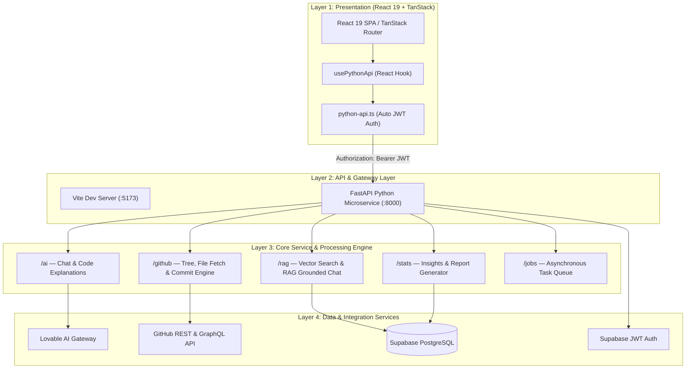

# CortexAI — AI-Powered Developer Workspace & Intelligence Engine

[](https://opensource.org/licenses/MIT)
[](https://react.dev/)
[](https://fastapi.tiangolo.com/)
[](https://www.typescriptlang.org/)
[](https://www.python.org/)
[](https://supabase.com/)
[](https://vitejs.dev/)

> **CortexAI** is a cloud-native, AI-orchestrated developer workspace and intelligence platform. It bridges codebase exploration, vector-indexed repository retrieval (RAG), live code editing in Monaco with GitHub commit synchronization, automated architecture report generation, and real-time team collaboration into a unified interface.

---

## 📑 Table of Contents

- [Overview & Problem Solved](#-overview--problem-solved)
- [Key Features & Highlights](#-key-features--highlights)
- [System Architecture](#-system-architecture)
- [Data Models & Schema](#-data-models--schema)
- [Technology Stack](#-technology-stack)
- [Repository Directory Structure](#-repository-directory-structure)
- [Local Setup & Installation](#-local-setup--installation)
  - [Prerequisites](#prerequisites)
  - [1. Clone Repository](#1-clone-repository)
  - [2. Frontend Setup](#2-frontend-setup)
  - [3. Backend Setup (FastAPI)](#3-backend-setup-fastapi)
  - [4. Supabase Database Setup](#4-supabase-database-setup)
- [API Reference](#-api-reference)
- [Deployment](#-deployment)
- [Contributing & License](#-contributing--license)

---

## 💡 Overview & Problem Solved

Developers often juggle fragmented tools to understand complex codebases, query documentation, edit files across branches, and share insights with teammates. **CortexAI** unifies these workflows into a single workbench:

1. **Information Fragmentation**: Navigating massive codebases is slow. CortexAI indexes repositories into vector chunks to enable grounded, context-aware code search and semantic Q&A.
2. **Context Switching**: Rather than bouncing between GitHub, local IDEs, and external LLM portals, CortexAI embeds a full Monaco editor with direct commit capabilities and in-line code explanations.
3. **Collaboration Overhead**: Built-in team channels, audit logs, and role-based repository access allow engineering teams to collaborate with real-time transparency.

---

## ✨ Key Features & Highlights

- 🤖 **Context-Grounded AI Co-Pilot**: Multi-turn dialogue powered by Lovable AI Gateway with code context awareness and token-efficient caching.
- 📚 **RAG Repository Indexing & Vector Search**: Automatic repository chunking stored in PostgreSQL with hybrid vector & full-text keyword retrieval.
- 💻 **In-Browser Monaco Editor**: Visual Studio Code-like editing experience with syntax highlighting, live diffs, and direct GitHub branch committing.
- 🗂️ **Interactive Repository Navigator**: Dynamic file tree exploration, syntax-highlighted code viewer, and one-click AI explanations for any file.
- 👥 **Team Workspaces & Channels**: Real-time team messaging channels with membership management and collaborative chat.
- 🔐 **Enterprise Access Control (RBAC)**: Fine-grained repository permissions, pending access requests, and immutable audit logs.
- 📊 **Automated Architecture & Tech Reports**: Instant generation of downloadable Markdown reports synthesizing project architectures, dependencies, and health metrics.
- ⚡ **Dual-Tier Polyglot Architecture**: React 19 frontend utilizing TanStack Router / Start paired with a high-throughput Python 3.12 FastAPI microservice.

---

## 🏛️ System Architecture

CortexAI operates on a clean separation of concerns:



### End-to-End Request Workflow

1. **Authentication Flow**: Users authenticate via Supabase Auth in the React UI. Every outgoing request through `python-api.ts` attaches the user's active session JWT (`Authorization: Bearer <token>`).
2. **Token Verification**: FastAPI middleware (`lib/auth.py`) verifies and unpacks the JWT using the shared Supabase secret.
3. **Repository Sync & RAG**: Repositories are fetched via GitHub API, split into semantic chunks, and persisted in `repo_chunks`. Vector queries retrieve relevant context snippets prior to prompt generation.
4. **Code Execution & Commits**: Code edits from the Monaco editor dispatch to `/github/commit` to push changes directly into target GitHub branches.

---

## 🗄️ Data Models & Schema

The underlying Supabase PostgreSQL database includes 11 structured tables:

| Table | Purpose |
|---|---|
| `profiles` | User profiles linked to Supabase Auth (`user_id`, username, avatar, role) |
| `channels` | Team discussion channels (`name`, `topic`, `created_by`) |
| `channel_members` | Association between users and channels (`channel_id`, `user_id`) |
| `messages` | Chat messages across channels |
| `repo_chunks` | Code chunks, vector embeddings, and full-text tokens for RAG retrieval |
| `gh_repo_cache` | Cached GitHub repository metadata and tree structures |
| `gh_file_cache` | Cached raw source file contents with truncation indicators |
| `ai_explain_cache` | SHA-256 content-hash keyed cache for AI code explanations |
| `repository_collaborators` | Registered repository collaborators and roles |
| `repository_permissions` | Granular repository permissions (read, write, admin) |
| `repository_access_requests` | Formal access request workflow state |
| `access_audit_logs` | Immutable audit trail for repository security events |
| `github_app_installations` | GitHub App integration accounts and installations |
| `user_github_tokens` | Secure user-level GitHub PAT / OAuth tokens |
| `jobs` | Asynchronous task queue and worker state tracking |

---

## 🛠️ Technology Stack

| Layer | Technologies |
|---|---|
| **Frontend Framework** | React 19, TypeScript, TanStack Start & Router |
| **Styling & UI Components** | Tailwind CSS v4, Radix UI primitives, Lucide React, Vaul, Recharts |
| **Code Editor** | Monaco Editor (`@monaco-editor/react`) |
| **Backend Framework** | Python 3.12, FastAPI, Uvicorn, Pydantic v2 |
| **HTTP & Networking** | HTTPX (async client with retries), Fetch API |
| **Database & Auth** | Supabase (PostgreSQL), Supabase Vector / pgvector, Supabase JWT Auth |
| **AI Integration** | Lovable AI Gateway (`ai.gateway.lovable.dev`), OpenAI / Claude model abstractions |
| **Tooling & Bundlers** | Vite 7, Bun / npm, ESLint, Prettier |

---

## 📂 Repository Directory Structure

```text
cortex-ai-work-space/
├── backend/                       # Python FastAPI Microservice
│   ├── main.py                   # Application entry point & CORS configuration
│   ├── requirements.txt          # Python dependencies
│   ├── .env.example              # Backend environment template
│   ├── lib/
│   │   ├── auth.py               # Supabase JWT authentication middleware
│   │   ├── github_client.py      # Resilient GitHub API client with retries
│   │   └── supabase.py           # Supabase administrative client singleton
│   └── routers/
│       ├── ai.py                 # Multi-turn chat & file explanation endpoints
│       ├── github.py             # Tree navigation, file read & direct commit APIs
│       ├── jobs.py               # Background job management
│       ├── rag.py                # Semantic repo chunking & vector search
│       └── stats.py              # Metrics aggregator & architecture report generator
│
├── src/                           # React 19 Client Application
│   ├── components/               # Radix UI and Tailwind interface components
│   ├── hooks/                    # Custom React hooks (useAuth, usePythonApi)
│   ├── integrations/             # Third-party SDK wrappers (Supabase, GitHub, Lovable)
│   │   └── supabase/             # Supabase client, middleware, and database types
│   ├── lib/                      # Python API typed client & server functions
│   │   └── python-api.ts         # Strongly-typed bridge to FastAPI endpoints
│   ├── routes/                   # TanStack Router page views
│   │   ├── index.tsx             # Main dashboard
│   │   ├── auth.tsx              # Authentication (Login / Register)
│   │   ├── chat.tsx              # AI Co-Pilot dialogue view
│   │   ├── repository.tsx        # File tree & source viewer
│   │   ├── repo-chat.tsx         # RAG-grounded codebase chat
│   │   ├── editor.tsx            # Monaco editor & GitHub committer
│   │   ├── access.tsx            # Repository RBAC access management
│   │   ├── team.tsx              # Team workspace & real-time channels
│   │   ├── reports.tsx           # Architecture summary generator
│   │   └── docs.tsx              # Documentation & reference hub
│   └── styles.css                # Global styling & Tailwind directives
│
├── supabase/                      # Database Schema & Migrations
│   ├── config.toml               # Supabase CLI configuration
│   └── migrations/               # 11 incremental PostgreSQL migration scripts
│
├── public/                        # Static assets and icons
├── .env.example                   # Frontend environment template
├── components.json                # shadcn / ui configuration
├── package.json                   # Node.js dependencies and run scripts
├── render.yaml                    # Full-stack Blueprint for Render deployment
├── tsconfig.json                  # TypeScript compiler settings
├── vite.config.ts                 # Vite bundler configuration
└── wrangler.jsonc                 # Cloudflare Workers / Pages configuration
```

---

## 🚀 Local Setup & Installation

### Prerequisites

Ensure you have the following installed:
- **Node.js**: `v18.0.0` or higher (Node 20+ recommended) or **Bun**: `v1.1+`
- **Python**: `v3.10` or higher (Python 3.12 recommended)
- **Git**
- A **Supabase** account and project

---

### 1. Clone Repository

```bash
git clone <YOUR_GITHUB_REPO_URL>
cd cortex-ai-work-space
```

---

### 2. Frontend Setup

1. **Install dependencies:**
   ```bash
   npm install
   ```

2. **Configure environment variables:**
   Copy `.env.example` to `.env`:
   ```bash
   cp .env.example .env
   ```
   Fill in your configuration:
   ```env
   VITE_SUPABASE_URL=https://your-project.supabase.co
   VITE_SUPABASE_PUBLISHABLE_KEY=your-supabase-publishable-key
   VITE_PYTHON_API_URL=http://localhost:8000
   ```

3. **Start the frontend development server:**
   ```bash
   npm run dev
   ```
   The frontend will be live at `http://localhost:5173`.

---

### 3. Backend Setup (FastAPI)

1. **Navigate to the backend directory:**
   ```bash
   cd backend
   ```

2. **Create and activate a virtual environment:**
   ```bash
   # Windows
   python -m venv .venv
   .venv\Scripts\activate

   # macOS / Linux
   python3 -m venv .venv
   source .venv/bin/activate
   ```

3. **Install dependencies:**
   ```bash
   pip install -r requirements.txt
   ```

4. **Configure backend environment variables:**
   Copy `backend/.env.example` to `backend/.env`:
   ```bash
   cp .env.example .env
   ```
   Configure the following variables:
   ```env
   SUPABASE_URL=https://your-project.supabase.co
   SUPABASE_SERVICE_ROLE_KEY=your-supabase-service-role-key
   SUPABASE_JWT_SECRET=your-supabase-jwt-secret
   LOVABLE_API_KEY=your-lovable-api-key
   ALLOWED_ORIGINS=http://localhost:5173,http://localhost:3000

   # Optional GitHub App integration
   GITHUB_APP_ID=
   GITHUB_APP_PRIVATE_KEY=
   GITHUB_APP_SLUG=
   ```

5. **Start the FastAPI backend server:**
   ```bash
   uvicorn main:app --reload --port 8000
   ```
   The backend will start at `http://localhost:8000`.

---

### 4. Supabase Database Setup

Run the migrations in `supabase/migrations/` in chronological order against your Supabase project using the Supabase CLI or SQL Editor:

```bash
supabase db push
```

---

## 🔌 API Reference

When the FastAPI server is running, explore interactive Swagger documentation at:
- **Interactive Swagger UI**: `http://localhost:8000/docs`
- **ReDoc Documentation**: `http://localhost:8000/redoc`
- **Health Check**: `GET http://localhost:8000/health`

### Primary Endpoints

| Category | Endpoint | Method | Description |
|---|---|---|---|
| **AI** | `/ai/chat` | `POST` | Multi-turn AI conversational completions with repo context |
| **AI** | `/ai/explain` | `POST` | Comprehensive code explanations with hash-based caching |
| **GitHub** | `/github/repo` | `POST` | Fetch repository file tree nodes and metadata |
| **GitHub** | `/github/file` | `POST` | Fetch single file content with encoding resolution |
| **GitHub** | `/github/commit` | `POST` | Push file modifications directly to a GitHub branch |
| **RAG** | `/rag/index` | `POST` | Parse, chunk, and index repository files into PostgreSQL |
| **RAG** | `/rag/chat` | `POST` | Context-grounded Q&A with source references |
| **Stats** | `/stats/dashboard` | `GET` | System metrics, active repos, and cached item counts |
| **Reports** | `/stats/report` | `POST` | Generate downloadable architectural summary reports |
| **Jobs** | `/jobs` | `GET` / `POST` | Asynchronous task queue status and submission |

---

## 🌐 Deployment

### Deploy to Render

This repository includes a production-ready `render.yaml` blueprint defining:
1. **Frontend Static Site**: Built with `npm run build`, published from `.output/public`.
2. **Backend Web Service**: Python FastAPI server launched via Uvicorn.

To deploy:
1. Connect your GitHub repository to [Render](https://render.com).
2. Click **New +** > **Blueprint**.
3. Select this repo and populate the required environment secrets.

---

## 📄 License

This project is licensed under the [MIT License](LICENSE).
